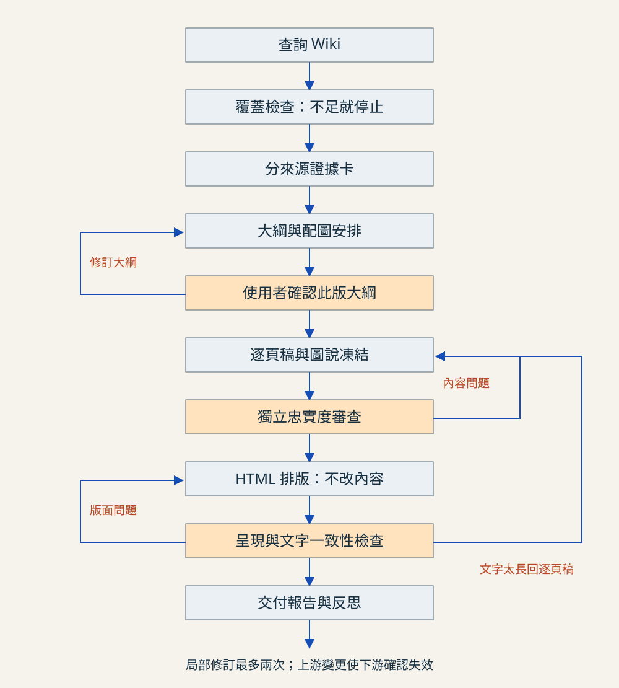

# 第二版：有關卡與局部重做的 Graph

這份流程依老師的[課堂講義](https://drive.google.com/file/d/15qN58f28Hxfl0v32z_Nbw2C3F6sEEjr8/view)調整。第一版簡報保留；既有測試結果只代表第一版檢查，不能當成第二版獨立審查通過。

## Graph 與 Loop 分別負責什麼

Graph 決定節點順序、分支、誰能讀寫哪些成果。Loop 是某個節點失敗後，依回饋重做並重新檢查的循環；不是把所有工作從頭再做一遍。

主線：查詢 Wiki → 覆蓋檢查 → 每來源證據卡 → 大綱 → 使用者確認 → 逐頁稿 → 獨立忠實度審查 → HTML 排版 → 呈現檢查 → 交付。

| 節點 | 可讀取的資料 | 交付物與檢查 | 失敗退回 |
| --- | --- | --- | --- |
| 查詢 | 需求、Wiki、主張索引 | retrieval.json；薄膜、微影、蝕刻均有條目 | 資料不足就停止並列缺口 |
| 證據卡 | 一份來源筆記及該來源的引用頁碼 | cards/Sxx.json；五份皆有實際採用主張 | 該來源卡；必要時回原頁 |
| 大綱 | 查詢結果、證據卡 | outline.json 與可閱讀大綱；每頁一個目的 | 大綱；缺證據才回查詢 |
| 人工關卡 | 大綱與配圖計畫 | 使用者明確同意此版大綱，綁定檔案摘要 | 修改大綱後再次確認 |
| 逐頁稿 | 已確認大綱、該頁對應卡 | drafts；正文、圖說、測驗及回饋都凍結 | 指定頁面 |
| 獨立審查 | 逐頁稿與來源，隔離作者對話 | review；只列判斷、問題、證據，不自行修改 | 錯誤頁面或錯誤卡 |
| 排版 | 審查通過逐頁稿 | HTML；不得重寫正文、圖說、測驗或回饋 | 排版；文字太長退回逐頁稿 |
| 呈現檢查 | HTML、凍結逐頁稿 | 鍵盤、手機、截圖、列印 PDF 與文字一致性紀錄 | 排版或逐頁稿 |
| 交付 | 所有實際紀錄 | 報告與反思 | 有未解問題不得宣稱完成 |

## 局部 Loop 與停止條件

每個修訂節點最多重做兩次，第三次仍需修訂就停止，呈現問題與需要的決策。來源不足、引用頁碼不明、待確認科學主張，立即停止受影響內容；不得自行填補。修改上游成果後，下游確認與審查失效，需重新執行。審查與修訂分工，程式檢查不代替科學內容審查。

## 本次落地範圍

執行 `node scripts/workflow.mjs prepare`，建立第二版的查詢、五份來源卡、大綱與狀態。這是從已 ingest 的筆記整理引用卡，不是重新閱讀五份 PDF，也不是獨立 AI 審查。來源卡保留完整來源筆記與引用位置；跨來源整合主張只用來定位，不宣稱各單一來源都支持整句。

執行 `node scripts/workflow.mjs status` 查看關卡。重跑 prepare 前必須明確處理現有成果，不會覆寫紀錄。人工確認前曾實測拒絕跳到排版；現在本輪狀態為 complete，實際退回與複驗見 [執行報告](v2-check-report.md)。

使用者已確認大綱，並同意隔離作者對話的獨立 AI 審查。後半段由 `scripts/graph-control.mjs` 控制：approve → freeze → review → render → complete。審查退回時進入 revision_required，再 freeze 會計算修訂次數，超過兩次即停止。每個命令會核對大綱、知識來源、凍結稿件或成果的版本摘要。建置程式也會拒絕未通過審查或與凍結稿不同的內容。

這是「AI 執行節點＋程式控制關卡」的檔案式 Graph，不是無人值守的自主生成服務。讀寫範圍是執行契約；只有關卡與版本檢查由程式強制執行，不宣稱具有作業系統層級的節點權限隔離。版面修訂須人工記錄次數並重新檢查；目前程式強制上限的是內容修訂。

## 與第一版的差異及目前反思

第一版將查詢、大綱與生成接得太緊，缺少可留下版本證據的人工關卡；第一版的程式及瀏覽檢查也不能代表獨立內容審查。現在把證據覆蓋與大綱確認移到生成前，先停下來查核再往後走。沒有足夠第二版執行紀錄，尚不能判定哪個節點「最常」出錯。

第二版實際大綱：[outline-v2.md](outline-v2.md)。本輪初審發現兩項阻擋問題，修訂一次後複審通過；這是一次執行紀錄，不足以推論長期錯誤頻率。舊流程留存於 [graph.md](graph.md)，僅作第一版歷史。
