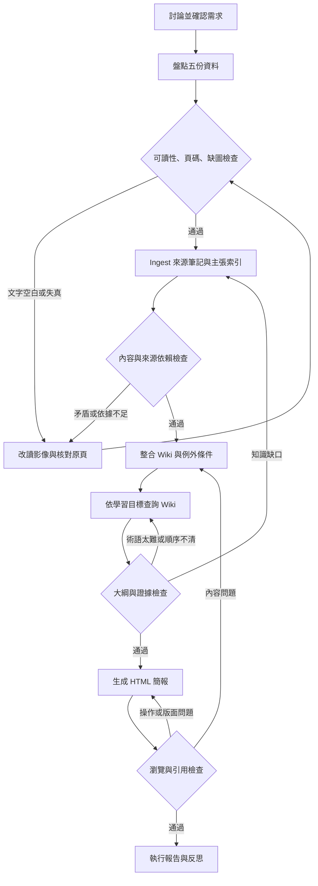

# Workflow / graph

> 這是第一版歷史流程。第二版節點權限、人工關卡與局部 Loop 請見 [受控流程](controlled-graph.md)，以及 [待確認大綱](outline-v2.md)。

## 每個節點交付什麼
| 節點 | 輸入 | 輸出與通過條件 |
| --- | --- | --- |
| 需求確認 | 作業與使用者討論 | requirements.md，主題、對象已確認 |
| 可讀性檢查 | PDF | 頁碼、讀取方法、缺圖紀錄 |
| Ingest | 已讀頁面 | Sxx 筆記與 Cxx 主張，所有主張有頁碼 |
| 內容檢查 | 來源筆記 | 例外、依賴與採用理由 |
| Wiki 整合 | Cxx | 概念條目與互相連結 |
| Wiki 查詢 | 學習問題 | retrieval.md 與簡報大綱 |
| 生成 | 已查核大綱 | slides/content.json 與 HTML |
| 驗證 | 成品 | check-report.md，失敗修復後重跑 |

讀取失敗只重做對應來源；內容缺口先修 Wiki；版面問題只修改呈現。若原檔真的缺圖，記錄不可用並選用有證據的文字說明，不無限重試。

流程圖的可離線瀏覽版本： [graph.html](graph.html)。這是以 LLM 協助執行、檔案作為知識庫的工作流程；沒有宣稱建置自主 agent 或向量檢索服務。
